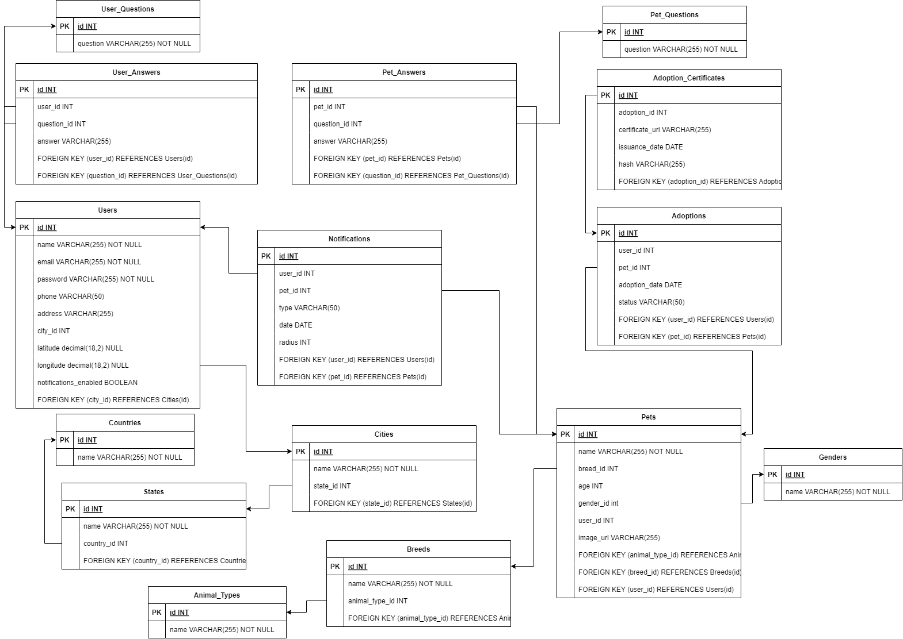

# Adoption and matching reference model

Owner decision, 11 November 2026: use the entity relationship diagram from the owner's master's thesis as the reference model for adoptions and adopter–pet matching. It defines the questionnaires that feed the compatibility model and future adoption matches.

Questionnaire content: the thesis survey defines the initial adopter and pet questions and options. [Survey summary and question bank](survey-summary.md)

Source: `documents/tesis/UNIR_ERD.drawio.png` and the data dictionary in the thesis final draft (`documents/tesis/Borrador Final.docx`). The species and breed seed list is in `documents/tesis/Especies-Razas.xlsx`.

## Scope

This diagram governs the adoption and matching area. The rest of the persistence model (accounts, Business profiles, prices, payments, subscriptions, invoices, consents, moderation) is still pending as the approved entity relationship model.

| Area | Thesis tables | Use in Petyei |
| --- | --- | --- |
| Matching questionnaires | `User_Questions`, `User_Answers`, `Pet_Questions`, `Pet_Answers` | Adopter and pet questionnaires. Training features for the compatibility model. |
| Pets | `Pets`, `Pet_Images`, `Breeds`, `Animal_Types`, `Genders` | Pet profile and catalogs. Seed species and breeds from the spreadsheet. |
| Adoptions | `Adoptions` (with `Score`), `Adoption_Documents` | Adoption requests and outcomes. `Score` stores the compatibility score at request time; outcomes become training labels. |
| Notifications | `Notifications`, `Notifications_Users` (radius) | Alerts about nearby pets that match saved preferences. |
| Users and locations | `Users`, `Countries`, `States`, `Cities` | Map to Petyei accounts and the DIVIPOLA catalog instead of duplicating them. |

## Required adaptations before migrations

Record these as proposed model changes and confirm them with the owner before generating migrations:

- Add the logical deletion status, `DeletedAt`, and `DeletedBy` to every entity, with the indexes required by the project rules.
- Use English code identifiers and explicit physical mappings; replace `INT` keys if the approved global model uses another key type.
- Store questionnaire answers in a structured form for training: question type, allowed options, and numeric or option values, with a question version. Free text alone does not produce usable features.
- Add `Adoptions` outcome states and timestamps that serve as labels (requested, approved by publisher, completed, returned).
- Replace `Users.password` with the password hash, and keep phone and address under the privacy rules.
- Link locations to the DIVIPOLA catalog and keep latitude and longitude with enough precision; `decimal(18,2)` is too coarse for coordinates.
- `Adoption_Certificates` used an Ethereum hash in the thesis. The owner ruled out Ethereum and any blockchain; drop the hash column and keep certificates in PostgreSQL and MinIO with audit history.
