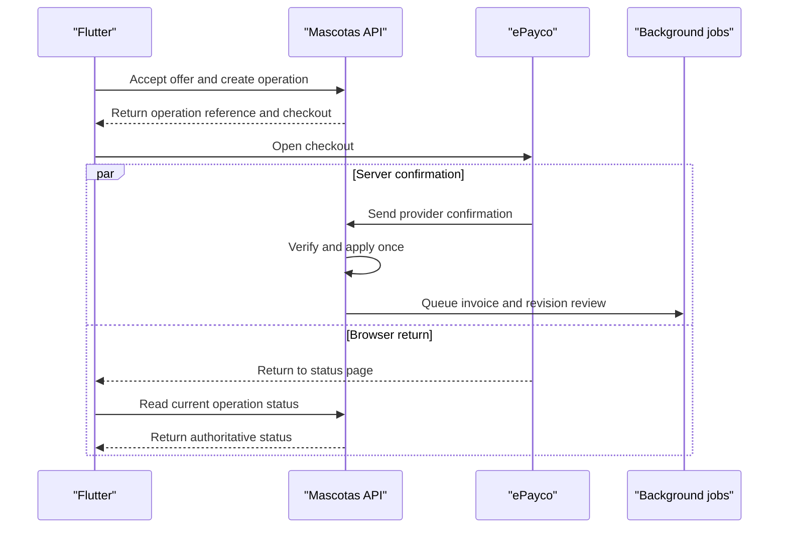

# Mascotas Phase 1 implementation specification

Use this specification with the project memory and work plan. [Project memory](https://github.com/erickvalderrama/it/blob/main/CLAUDE.md) · [Work plan](https://github.com/erickvalderrama/it/blob/main/prompts/mascotas/work-plan.md)

Phase 1 delivers adoption discovery and publishing, premium checkout, Business enrollment and membership, and the tools to operate them. Start the Colombia pilot with responsive web checkout and shared Flutter screens for web, Android, and iOS.

The routes, field names, state values, limits, and payloads below are implementation proposals. Reconcile them with existing code and the approved entity relationship model. Use logical contracts and synthetic fixtures for independent work while the model is pending. Derive physical tables, mappings, constraints, and migrations from the approved model. Use the reviewed business settings for real prices, benefits, durations, refunds, and availability.

## Build sequence

| Slice | Build and demonstrate | Dependency |
| --- | --- | --- |
| 1A.1 Project bootstrap | Build and start the API and Flutter web containers from a fresh clone. Expose health endpoints, connect the first Flutter screen, publish the API contract, and run CI with a synthetic fixture. | Pin the toolchain and set the external service configuration for integration checks. |
| 1A.2 Access and locations | Select a Colombian city, register, sign in, change city, and accept the current terms. Reopen an existing operation after terms change. | Approved identity, location, and consent mappings for persistence. |
| 1A.3 Business enrollment | Convert an existing account to a Foundation or Store profile. Demonstrate the same account, private Store documents, verification, and promotion status. | Approved organization and membership mappings. |
| 1B.1 Basic adoption | Create a draft, upload photos, preview, submit a revision, pass simulated moderation, then find the listing using city and publisher filters. | Approved listing, media, and revision mappings. |
| 1B.2 Moderation and contact | Handle corrections, rejection, and manual review. Give the visitor the agreed adoption contact action and the publisher a way to manage it. | Review rules and approved contact channel. |
| 1C.1 Premium and renewal | Accept a price and terms, open checkout, confirm once, and show separate listing, payment, invoice, or membership status. | Approved price, payment, membership, and invoice mappings. Use controlled provider responses first. |
| 1C.2 Provider validation | Verify checkout return, server confirmation, partial failure recovery, invoice issuance, and refunds in authorized test environments. | Provider access and the approved billing and refund rules. |
| 1D Pilot operations | Run the Superadmin queues, two-city E2E suite, responsive visual checks, deployment smoke test, and recovery exercises. | Operational owners, reviewed legal documents, and configured pilot cities. |

Use one ticket per testable slice. Write the expected user outcome, the contract change, the role and ownership rules, one successful scenario, the relevant failure or retry scenario, and the verification commands. Link screenshots for changed screens and record any migration or deployment impact in the same change. The first demo is a basic adoption visible in the correct city after review.

## Repository and local development

| Area | Suggested starting point for a new project |
| --- | --- |
| Backend | `src/Mascotas.Domain`, `src/Mascotas.Application`, `src/Mascotas.Infrastructure`, and `src/Mascotas.Api`. Group use cases by feature within each layer. |
| Flutter | `apps/mascotas_app/lib/app` for bootstrap, routing, and theme. Use `lib/core` for shared HTTP and UI components and `lib/features` for auth, locations, adoptions, Business, checkout, legal, and administration. |
| Tests | `tests` for .NET unit and API/PostgreSQL integration suites. Use Flutter `test` for Dart and widget tests and `integration_test` for user journeys. |
| Contracts and setup | Keep the OpenAPI contract, this specification, Dockerfiles, Docker Compose, and run instructions in version control. Connect to the existing PostgreSQL and self-hosted MinIO services with separate test scopes and reproducible fixtures. |

- Pin the approved .NET SDK, EF Core and Npgsql combination, and Flutter SDK. Record the existing PostgreSQL major version and exercise compatibility on authorized test databases. Keep project dependencies and lockfiles reproducible.
- Document PowerShell-compatible and shell-compatible commands for restore, building and starting app containers, connecting to external services, applying approved development migrations, loading fixtures, and running each test suite. Verify the documented workflow from a clean checkout.
- Validate configuration at startup. Propose `/health/live` for process liveness and `/health/ready` for deployment readiness. Keep database credentials, auth signing material, provider keys, storage credentials, and callback configuration server-side. Expose public configuration such as the API base URL to Flutter.
- Provide deterministic development and CI adapters for checkout, invoice issuance, moderation, and email. Make the application reject test adapters and synthetic seed routines in production. Exercise provider contracts separately in authorized test environments.
- Use one documented fixture reset that seeds Santa Marta (`CO`, `47`, `47001`), Barranquilla (`CO`, `08`, `08001`), two unrelated Business profiles, an individual publisher, a reviewer, listings in each city, two price versions, and two terms versions. Use synthetic accounts, images, and contact details. [Versioned location data](https://github.com/erickvalderrama/it/blob/main/prompts/mascotas/data/README.md)

### Container runtime and external services

Build the API and Flutter web images with reproducible builds. Use Compose for the application services. Add a worker service when background processing runs as a separate process. Serve Flutter web with a static server and a fallback for client routes. Configure the public API URL and verify deep links and payment return after reload. Build Android and iOS for their supported targets.

| Dependency | Runtime configuration and verification |
| --- | --- |
| Existing PostgreSQL | Connect from the API and worker to the external host using the approved database, role, and TLS settings. Propose `ConnectionStrings__Mascotas` for server configuration. Test reachability and read access from the container. Use a scoped database account and run approved migrations through the documented procedure. |
| Self-hosted MinIO | Configure the external endpoint, bucket or prefix, and scoped app credentials with server-side options such as `ObjectStorage__Endpoint`, `ObjectStorage__Bucket`, `ObjectStorage__AccessKey`, and `ObjectStorage__SecretKey`. Verify TLS and a write, read, and delete cycle for a synthetic object in test scope. |
| Media access | Store object references according to the approved model. Authorize uploads and downloads on the server. Keep identity documents and original private media in controlled storage. Test authorized delivery, photo derivatives, and recoverable storage failures. |

Use runtime secret injection and keep web configuration public. Test with a dedicated database and credentials on the external PostgreSQL host and a test bucket or prefix on MinIO. Validate target and permissions before fixture resets. Keep liveness process-only and make readiness checks bounded. Record the container commands and integration results in the work plan. [Docker Compose networking](https://docs.docker.com/compose/how-tos/networking/) · [ASP.NET Core configuration](https://learn.microsoft.com/en-us/aspnet/core/fundamentals/configuration/) · [MinIO .NET SDK](https://docs.min.io/aistor/developers/sdk/dotnet/)

## Data and validation

Use shared contract definitions for server validation and Flutter feedback. The server validates all writes and returns field errors. Show a recoverable message and preserve valid input. The limits below are pilot defaults to confirm against the model and upload policy.

| Flow | Input and validation |
| --- | --- |
| Personal registration | Require `displayName`, `email`, `password`, `countryCode`, and `cityCode`. Propose 2–80 characters for the trimmed name. Validate and normalize the email for uniqueness using the identity layer. Apply its password policy, allow password managers, and keep passwords out of logs and shared fixtures. Preselect Colombia and group eligible cities by department. |
| Location | Keep codes as text, including leading zeroes. Derive the department from the selected city and validate the relationship server-side. The listing city is selected independently of the account city. Import by official code and source version. Preserve existing references and keep pilot eligibility separate from source updates. |
| Business enrollment | Ask `profileType` first. Collect the profile name, city, and permitted contact fields. For Store, ask person type and the corresponding identity and tax documents from the work plan. Upload privately and show a checklist and verification status. Reuse the existing account on conversion. |
| Adoption draft | Propose required `petName`, `speciesCode`, `cityCode`, `description`, and at least one photo at submission. Use 1–60 characters for the name and 20–1,500 for the description. Allow draft saving before all required fields are complete. If age is collected, support approximate age or unknown. |
| Photos | Start with a proposed 1–5 photos and 8 MiB per upload. Validate the decoded format and size on the server. Support selected formats across targets, strip metadata from public and moderation derivatives, let the author reorder photos and select a cover, and handle upload failure per photo. |
| Publisher source | Require the actor to choose an individual or authorized Business context before submission. Freeze the published source on the listing. Check organization access on every read and write involving private Business data. |
| Adoption contact | Use one primary contact action for the pilot. A short authenticated request is a proposal for the first implementation. Keep the request and reply details scoped to the sender and authorized publisher, and provide feedback after submission. Confirm the channel before persisting requests or sharing contact data. |
| Legal and billing | Capture the exact document version accepted and server timestamp. Collect invoice data at checkout under the approved billing flow. Present phone or address only when the operation has a defined use for them. Keep private fields outside public results, moderation inputs, metrics, and test screenshots. |

Keep public projections narrow. Return the public pet profile, sanitized photos, city, publisher display name and source, availability, and allowed contact action. Serve drafts, identity documents, invoices, and private contacts through separately authorized views. Historical records retain the legal version, price, actor, and publisher source applicable to the operation.

## API contracts

Use `/api/v1` for the initial public and authenticated API contract. Generate or verify OpenAPI against the actual server and check DTO compatibility in CI. Use opaque identifiers, ISO 8601 UTC timestamps, and stable enum values. Display market dates and amounts using the configured locale while keeping base copy in English.

| Routes after `/api/v1` | Contract |
| --- | --- |
| `GET /locations?countryCode=CO` | Return enabled departments and cities with stable string codes and names. |
| `POST /auth/register`, `GET /me`, `PATCH /me` | Register, restore account context, and update allowed fields. Use the approved identity provider or module for session and recovery endpoints. |
| `GET /legal/documents/current`, `POST /legal/acceptances` | Read effective terms and privacy documents. Accept the exact applicable version and return the authoritative timestamp. |
| `POST /business/enrollments`, `GET /business/enrollments/{enrollmentId}` | Start or resume enrollment, return applicable document tasks and verification status. Attach documents with `POST /business/enrollments/{enrollmentId}/documents` and enforce private access. |
| `GET /business/membership` | Return membership status, expiry, benefits, and the next offered price when available. |
| `GET /adoptions`, `GET /adoptions/{listingId}` | Return eligible public listings and a shareable public detail. Support city and publisher filters and stable pagination. |
| `GET /me/adoptions`, `POST /me/adoptions`, `PATCH /me/adoptions/{listingId}` | List owned records, create or edit a draft, and return its revision. Compare `expectedRevisionId` on save to detect a concurrent edit. |
| `POST /me/adoptions/{listingId}/photos`, `POST /me/adoptions/{listingId}/submit` | Attach an authorized upload. Freeze a complete revision on submission. Return a queued review for basic or a revision ready to quote for premium. Resubmit a paid correction under the existing operation. |
| `GET /me/adoptions/{listingId}` | Return an owned listing and status, correction reasons, and linked operations. |
| `POST /checkout/offers`, `POST /checkout/operations`, `GET /checkout/operations/{operationId}` | Quote a premium listing or Business renewal, accept the exact offer, and read the authoritative result. Provide an authorized invoice link when available. |
| `POST /payments/epayco/confirmation` | Receive and verify the configured provider confirmation. Match the stored operation and process a confirmed result once. |
| `GET /admin/reviews`, `POST /admin/reviews/{reviewId}/decision` | Load the authorized queue and record a decision on the exact revision with a reason. |
| `GET /admin/summary`, `GET /admin/operations` | Show scoped user counts and pending moderation, payment, invoice, and refund work. Use explicit reconcile and retry actions with audit reasons. |
| `/admin/users`, `/admin/business-enrollments`, `/admin/prices`, `/admin/legal-documents` | Enable or suspend user access, decide Business verification, create price versions, and publish future legal versions. Enforce the actor's scope, validate effective dates, and audit sensitive changes. |

- For `GET /adoptions`, use `cityCode`, `publisherType`, `limit`, and `cursor`. Propose 20 items per page and a cap of 50. Return `items` and `nextCursor`. Keep ordering deterministic with the approved placement priority, activation time, and an ID tie-breaker. Bind cursors to filters and restart pagination when filters change.
- Use Problem Details with stable `code`, `traceId`, and field errors where applicable. Example codes are `VALIDATION_FAILED`, `TERMS_ACCEPTANCE_REQUIRED`, `QUOTE_EXPIRED`, `REVISION_CONFLICT`, and `INVALID_STATE`. Use `400` for field validation, `401` for missing authentication, `403` for denied authorized-scope actions, `404` for unavailable public or concealed resources, and `409` for state conflicts. Use safe user-facing messages. [ASP.NET Core API error handling](https://learn.microsoft.com/en-us/aspnet/core/fundamentals/error-handling-api)
- Use a server-generated reference for each checkout operation. For retryable mutations, define `Idempotency-Key` scoped to the actor and operation. Replaying the same key and payload returns the recorded result or pending operation. A changed payload under the same key returns a conflict. Enforce the invariant in approved persistence as well as the API.
- Represent money in the API with an exact decimal string and currency, using the approved precision. Calculate fees, tax components, discounts, and totals on the server. Freeze the displayed total, currency, price version, benefits, applicable terms version, and expiry in the offer and accepted operation.

Synthetic public search response for `GET /api/v1/adoptions?cityCode=47001&publisherType=individual&limit=20`.

```json
{
  "items": [
    {
      "listingId": "listing-basic-example-1",
      "petName": "Luna",
      "speciesCode": "dog",
      "cityCode": "47001",
      "publisherType": "individual",
      "coverPhotoUrl": "https://example.test/media/luna-cover.webp"
    }
  ],
  "nextCursor": null
}
```

Synthetic premium offer payload for contract tests.

```json
{
  "offerId": "offer-example-1",
  "product": "premium_adoption",
  "listingId": "listing-example-1",
  "revisionId": "revision-example-2",
  "priceVersionId": "price-example-v2",
  "termsVersionId": "terms-example-v1",
  "currency": "COP",
  "total": "20000.00",
  "durationDays": 7,
  "expiresAt": "2030-01-15T16:00:00Z"
}
```

## Workflow and consistency rules

| Workflow | States exposed to the UI | Transition and invariant |
| --- | --- | --- |
| Listing | Draft, awaiting payment, awaiting review, visible, closed | Basic submission queues review. Premium queues review after a verified payment. Activate the approved revision once and start premium time from activation. Remove closed or expired visibility according to the offer and listing rules. |
| Moderation | Queued, in review, corrections required, manual review, approved, rejected | Evaluate text, all photos, and visible text in photos under the same policy version. Approve only with a passing result for every required input. Deny clear sexual content, vulgarity, or other clear policy violations. Route uncertainty and persistent provider failure to Superadmin. |
| Payment | Pending, confirmed, failed, requires reconciliation | The browser return loads server status. Apply a verified confirmation once. Handle late or inconsistent confirmations through reconciliation before changing the operation. |
| Invoice | Pending, issued, retry required, adjusted when applicable | Tie issuance to the confirmed own charge. Keep invoice failure recoverable after payment confirmation. Recheck provider issuance before retrying an uncertain result. |
| Refund | Pending, completed, retry required where applicable | Use the approved policy and an authorized actor. Link the original charge and applicable adjustment, and reconcile provider status before replaying an uncertain request. |
| Business membership | Verification pending, promotional, active, expired | Apply the promotion when eligible and activate a renewal after confirmed payment. Store the accepted price and exact period boundaries. Retain access to previous obligations and records. |

- Capture a submission with immutable content revision, publisher context, and expected photo IDs. Apply a review outcome to that revision only. On correction, show the field or photo, reason, and next action. Resubmit the corrected revision with the original paid operation and terms. Leave an unapproved revision private and record stale results for audit. For an edit to an active listing, expose the last approved revision while the replacement is reviewed if the publication rules allow it.
- Persist the confirmed payment and a durable reference for follow-up work before reporting success. Deduplicate verified provider events and make review and invoice jobs safe to retry independently. A second genuine charge with a different provider reference goes to reconciliation with its own traceable record.
- For an expired offer or a superseded terms version before acceptance, display the updated summary and obtain current acceptance before starting checkout. Record late callbacks against the original operation. If the previous attempt is unresolved, let the user reopen status or request support before allowing another charge.
- For each status change, persist the server time, actor or provider, reason where applicable, and correlation reference. Use explicit, audited administrative reconcile and retry actions for recovery. Treat any configured deadlines as inclusive starts and exclusive ends.



Use the provider's test environment to verify checkout, confirmation, and reference lookup. For unresolved operations, show the internal operation, provider reference, last verified status, and safe next action in the admin queue. [ePayco response and confirmation](https://docs.epayco.com/docs/checkout-respuesta-y-confirmacion)

## UI/UX design and usability

Use the primary user task to decide the content order, navigation, and interaction. Before implementing a critical screen, sketch the entry point, one primary action, expected success, recovery path, and how it reflows at compact and wide widths. Review the sketch with fixtures while API work proceeds.

| User journey | Design and usability acceptance |
| --- | --- |
| Find a pet | A visitor can browse with no account, understand which city is selected, distinguish individual and organization listings, and reach the contact action from a shared detail. Ask for sign-in only when required by the action and preserve the destination. |
| Publish an adoption | A first-time publisher can save a draft, see which fields or photos need attention, preview what becomes public, and understand the free and paid choices. The paid choice shows the total, duration, and when visibility starts before confirmation. |
| Resume after payment or correction | A publisher can return from checkout or refresh the browser and tell whether payment, review, or invoicing needs attention. A correction identifies the exact field or photo and leads back to resubmission under the existing payment. |
| Enroll a Business | The first choice explains Foundation and Store. Show only the document tasks that apply, when verification is pending, and how long the promotion lasts. |
| Review an operation | Staff can find the correct listing revision or charge, see why it needs attention, and understand the effect of an audited decision or retry. |

Use concise copy that states the current result and next action. Example English strings are `Payment pending`, `Check payment status`, and `Replace photo {photoNumber} and resubmit. Your existing payment covers this update.` Keep them in named catalogs and render them from authoritative server states.

Observe pilot users completing discovery, publication, and correction with representative data. Include a first-time visitor and individual or Foundation publishers. Record where they hesitate or abandon the task, then fix blockers in the affected flow. Use keyboard and screen reader checks on the live interface alongside screenshot comparisons.

### Official light theme

**Bosque y pistacho** is the approved light palette for Mascotas. Use the same tokens in the web and mobile Flutter layouts. [Project memory](https://github.com/erickvalderrama/it/blob/main/CLAUDE.md#uiux-and-flutter-interface-for-web-and-mobile)

| Token | Color | Use |
| --- | --- | --- |
| `primary` | `#2B5735` | Forest green for primary actions, active navigation, and selected controls. |
| `accentContainer` | `#D7EC9E` | Pistachio background for featured listings and related highlights. |
| `canvas` | `#F5F8EE` | Light green background for screens. |
| `surface`, `onPrimary` | `#FFFFFF` | Cards, inputs, dialogs, and labels on filled primary buttons. |
| `onSurface`, `onAccentContainer` | `#243329` | Dark green text and icons on screens, surfaces, and featured labels. |

White on primary is 8.34:1 and dark green on pistachio is 10.36:1. Verify the implemented text pairs, focus indicators, and semantic status colors. Give each status an explicit label and check the palette in the visual regression tests. [WCAG text contrast](https://www.w3.org/WAI/WCAG22/Understanding/contrast-minimum.html)

## Flutter screens and interactions

| Screen or route proposal | Main action and acceptance |
| --- | --- |
| `/adoptions` | Choose city and publisher type, scan cards, and open a listing. Restore filters after returning from detail. Show empty results with an actionable filter change. |
| `/adoptions/:listingId` | Show photos, city, species, publisher, and the agreed contact action. Support a shareable link and an unavailable state for a closed listing. |
| `/register` and `/terms` | Complete the five registration fields, read legal documents, and resume the intended action after sign-in and applicable acceptance. |
| `/my/adoptions/:listingId/edit` | Save draft, upload and reorder photos, preview the public projection, and choose basic or premium. Preserve input on validation or network errors. |
| `/my/adoptions/:listingId` | Show review status and correction instructions by field or photo. Provide re-submit or authorized support actions. |
| `/checkout/:operationId` | Show the accepted amount, currency and benefits, payment status, and invoice separately. Reopen status after refresh or a return from checkout. Explain the next action while a payment is pending. |
| `/business/onboarding` and `/business/membership` | Choose profile type, complete applicable document tasks, see verification and promotion end date, and accept a renewal offer. |
| `/admin/reviews` and `/admin/operations` | Filter by state and city where applicable. Inspect the exact revision or operation. Require the reason for sensitive actions and display the resulting state. |

- Reuse the same routing contract, feature controllers, and API DTOs across web and mobile. Keep browse and detail deep links stable. Validate return destinations as internal routes. Display primary actions in reachable positions at each width. Move focus to a useful error summary or invalid field and announce significant status changes.
- Start with reusable city picker, listing card, photo picker, price summary, status display, field error, and empty/error components. Use named tokens for typography, spacing, color, and state. Keep common base strings and error messages in their English catalogs.
- Use sample goldens at 360×800, 768×1024, and 1440×900, adapted to the approved breakpoints. Cover loading, empty, error, pending payment, corrections, and approved states. Check long names, large amounts, enlarged text, keyboard and focus, safe areas, and screen reader labels. [Flutter adaptive and responsive guidance](https://docs.flutter.dev/ui/adaptive-responsive)
- Load thumbnails in the feed and fetch larger images on detail. Paginate the feed and admin queues. Measure search and detail response times and review query plans with pilot-like data before adding indexes beyond the approved model.

## Acceptance tests and pilot operations

| Scenario | Expected evidence |
| --- | --- |
| 1A location and access | Register with Colombia preselected, select `08001`, and verify the leading zero survives. Reject a mismatched or disabled locality. Verify a new terms version blocks a new protected operation while prior history stays available. |
| 1A Business isolation | A Foundation and a Store use the Business role. A natural-person or legal-entity Store sees its required documents. Verify the expected denial for a different Business attempting to view the files or act on its listing. |
| 1B publish and search | A basic draft becomes visible only after its exact revision passes. Searching Santa Marta returns eligible listings for Santa Marta and the selected publisher type. Refreshing the shared detail URL opens the same record. |
| 1B moderation | Simulate approval per photo, a correctable issue, sexual or vulgar content, and a missing image result. Check the private revision, author guidance, manual queue, and stale-result handling. |
| 1C duplicate and out-of-order events | Open checkout with price A, publish price B, then confirm twice after an early browser return and deliver a late pending event. Verify that confirmed status holds and the accepted amount and terms, applied payment, invoice workflow, and charged revision stay consistent. |
| 1C correction and failure recovery | Correct a paid listing and re-submit under the same payment. Simulate invoice timeout and retry, and verify the publication result stays independent. Exercise final rejection and the approved refund path. |
| 1C membership | Activate an eligible promotion, advance the test clock to expiry, accept the assigned renewal price, and confirm that retries preserve one renewal period and its accepted offer. |
| 1D pilot | Demonstrate the three roles in two cities, compare responsive goldens, reprocess a staged failed job, and complete an authorized provider smoke check. Record tested targets and actual outcomes. |

Use domain tests for transitions and amounts, API/PostgreSQL tests for permissions, migrations and concurrency, Flutter widget tests and goldens for screen states, and E2E for the complete workflows. Exercise repeat requests against real test persistence with provider fixtures at their boundaries.

- Before opening the pilot, agree the location allowlist, initial organizations, terms and privacy versions, review rules, contact channel, price and benefit settings, promotion window, refund policy, fiscal issuer, provider configuration, and the recovery owner.
- Define registered accounts as completed registrations, enabled accounts as accounts allowed to sign in, and active accounts using the approved activity event and time window. Use the proposed 30-day window consistently for the pilot and show its definition beside the count.
- Track time from draft to first visible listing, searches with zero results by city, and the share of eligible checkout operations that reach confirmed payment. Surface the oldest pending review and operations requiring reconciliation. Keep metrics free of contact, billing, and identity data.
- Release from a verified build with migration rehearsal, smoke tests, backup and restore evidence, and a clear rollback or forward-repair path. Use deployment flags to control paid flows by channel and environment after provider and legal validation.
